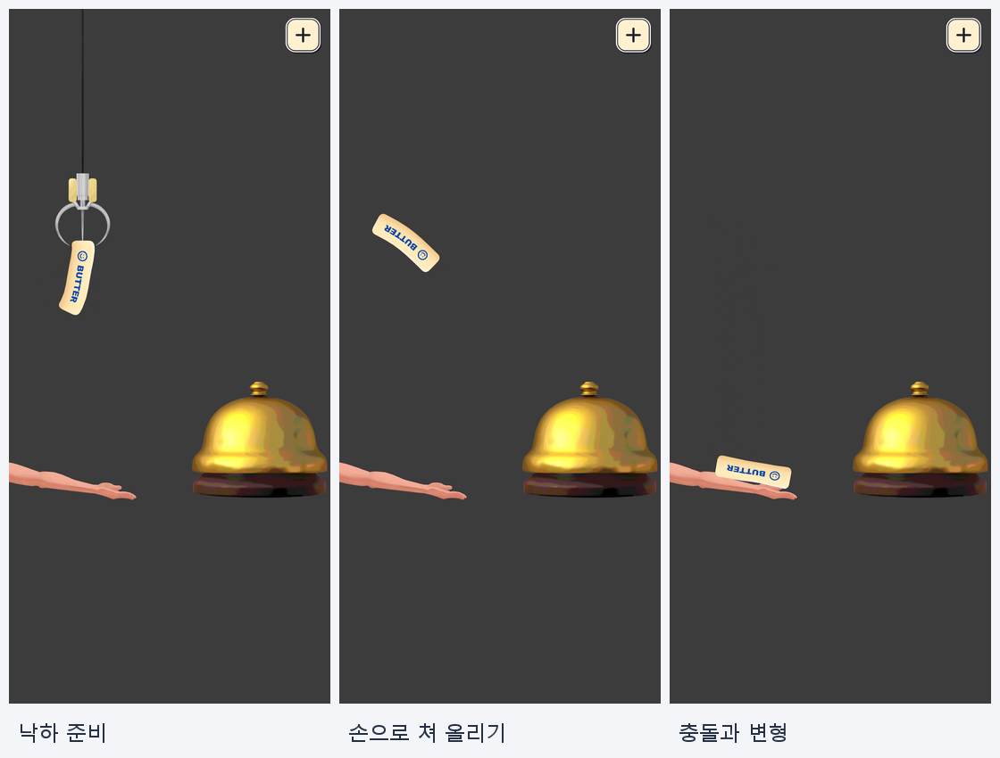
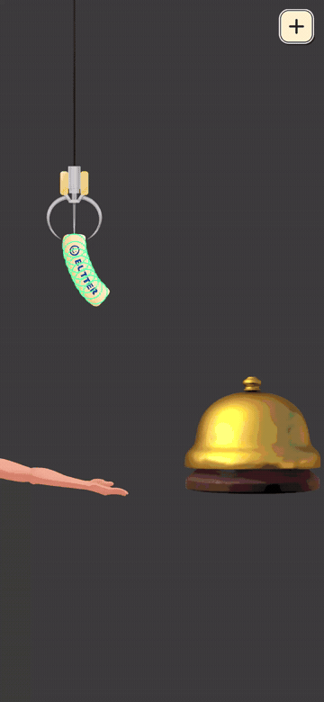
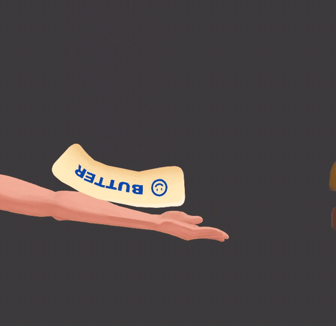
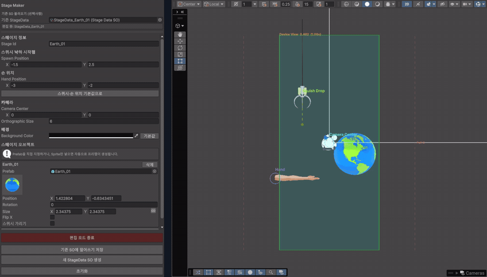
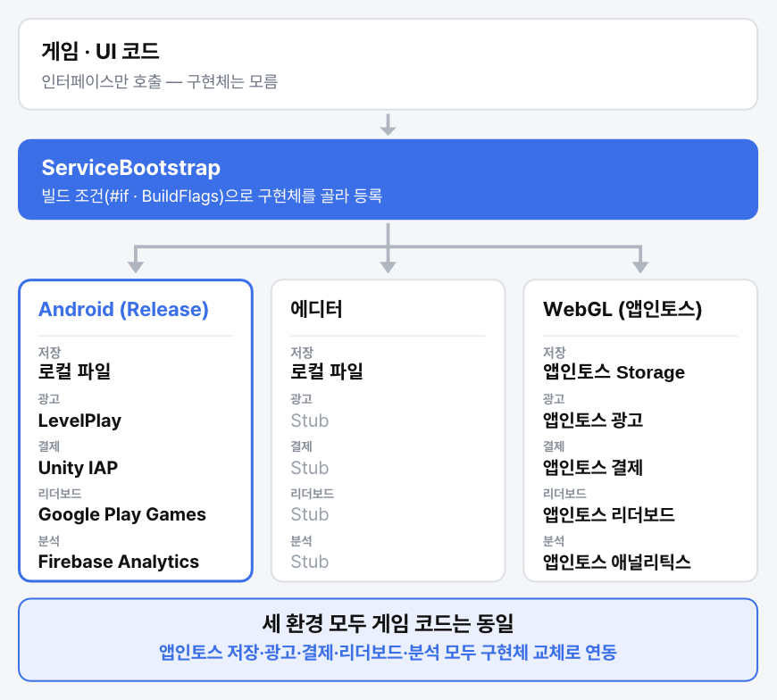

# ButterPop!

**쫀득한 스퀴시의 손맛과 ASMR을 느낄 수 있는 모바일 2D 물리 퍼즐 게임**

스퀴시를 떨어뜨리고, 손으로 쳐 올려 다양한 스테이지 오브젝트 위에 안착시키는 게임입니다.

**Google Play·앱인토스 출시 · gamescom asia 2026 전시**

4인 팀에서 메인 클라이언트 개발을 담당했으며, 소프트바디와 스테이지 제작 도구를 구현했습니다. 플랫폼별 광고·결제·저장·리더보드·애널리틱스 서비스도 구현하고 연동했습니다.

-  [Google Play](https://play.google.com/store/apps/details?id=com.fruitsghost.butterpop)
-  [상세 기술 포트폴리오 (PDF)](media/portfolio.pdf)
-  [플레이·구현 시연 영상](https://www.youtube.com/watch?v=ByeWOFnp3t4)

## 프로젝트 정보

| 항목 | 내용 |
|---|---|
| 개발 기간 | 2026.06 ~ 2026.09, 3개월 |
| 팀 구성 | 4인: 기획 · 아트 · 마케팅 · 개발 |
| 담당 역할 | 메인 클라이언트 개발 |
| 엔진 · 언어 | Unity 6 · URP · C# |
| 플랫폼 | Android (Google Play) / WebGL (앱인토스) |
| 주요 기술 | Unity 2D Physics, 런타임 Mesh, ScriptableObject, UniTask, Addressables, DOTween |
| 외부 서비스 | LevelPlay, Unity IAP, Google Play Games, Firebase Analytics, Apps in Toss |

## 핵심 구현

### 1. 2D 소프트바디

`Rigidbody2D`와 `HingeJoint2D`로 연결한 Bone 체인에 복원 토크를 적용해 휘어졌다 돌아오는 몸체를 구현했습니다. 런타임 메시가 Bone을 따라 움직이고 충돌 주변을 압축해 눌리는 외형을 표현합니다. 물리와 외형을 분리해 시각적 변형이 Collider와 안착 판정에 영향을 주지 않도록 구성했습니다.

<table>
<tr><th>Bone Collider와 관절 체인</th><th>충돌 주변 외형 변형</th></tr>
<tr><td></td><td></td></tr>
</table>

대표 코드: [SquishBody](Scripts/GamePlay/Controller/Squish/SquishBody/SquishBody.cs) · [SquishMesh](Scripts/GamePlay/Controller/Squish/SquishMesh.cs)

### 2. 스테이지 제작 도구

기획자가 오브젝트 배치와 카메라 설정을 편집하고 Scene View에서 확인할 수 있는 제작 도구를 개발했습니다. 편집 결과를 `StageDataSO`로 저장하고 런타임에서 재구성하는 흐름으로 **50개 스테이지를 제작하고 플레이 환경에서 검증**했습니다.

대표 코드: [StageMakerWindow](Scripts/Editor/StageMakerWindow.cs) · [StageBuilder](Scripts/GamePlay/Stage/StageBuilder.cs)

### 3. 플랫폼별 서비스 구성

게임·UI는 서비스 인터페이스를 사용하고, 광고·결제·저장의 게임 정책과 외부 SDK 호출을 분리했습니다. `ServiceBootstrap`에서 빌드 조건에 따라 Android SDK, 에디터용 Stub, 앱인토스 구현체를 선택해 등록합니다. 플랫폼 연동을 교체할 때 게임·UI의 서비스 호출 계약을 유지할 수 있도록 구성했습니다.

대표 코드: [ServiceBootstrap](Scripts/Core/ServiceBootstrap.cs) · [Services](Scripts/Core/Services.cs)

### 4. 광고·결제·저장 실패 대응

| 문제 | 대응 | 대표 코드 |
|---|---|---|
| 배너 최초 로드 실패 후 미노출 | 5·15·30·60초 재요청, 요청·로드·노출 상태 분리 | [LevelPlayProvider](Scripts/Core/Ad/LevelPlayProvider.cs) |
| 준비되지 않은 리워드 버튼 노출 | 광고 준비 상태 이벤트로 UI 갱신 | [UIInGameHUD](Scripts/UI/Scene/UIInGameHUD.cs) |
| 구매 확정 전 종료로 남은 미확정 주문 | 보유 주문 조회, 미확정 주문 확정과 권한 복원 | [UnityIapProvider](Scripts/Core/Purchase/UnityIapProvider.cs) |
| 스토어 무응답으로 구매 대기 지속 | 연결·조회 30초, 구매 900초 타임아웃과 대기 해제 | [UnityIapProvider](Scripts/Core/Purchase/UnityIapProvider.cs) |
| 저장 도중 중단되는 파일 쓰기 | 임시 파일 기록 후 기존 파일 교체 | [FileSaveStorage](Scripts/Core/Save/FileSaveStorage.cs) |
| 겹친 저장 요청의 임시 파일 충돌 | 이전 저장 완료 후 다음 저장을 순차 실행 | [SaveService](Scripts/Core/Save/SaveService.cs) |
| 저장 데이터 로드 실패 후 덮어쓰기 | 로드 실패 시 저장을 차단해 기존 데이터 보호 | [SaveService](Scripts/Core/Save/SaveService.cs) |

## 공개 범위

이 저장소는 **포트폴리오 검토를 위한 소스 열람용 저장소**입니다.

- `Scripts/`: 애플리케이션 C# 코드
- `media/`: 포트폴리오 PDF와 시연 자료
- Unity Scene·Prefab·원본 게임 에셋·프로젝트 설정·외부 SDK 원본은 포함하지 않아 **이 저장소만으로 실행하거나 빌드할 수 없습니다.**
- 운영 광고 설정·리더보드 식별자·앱인토스 상품 SKU는 공개용 예시 값으로 대체했습니다.

코드와 자료에 별도의 오픈소스 이용 허락을 선언하지 않습니다. 재사용·재배포 시 권리자의 허락과 관련 라이선스를 확인해주세요. 팀 제작 아트의 권리는 해당 권리자에게 있습니다.
