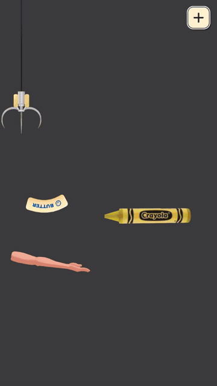

# ButterPop!

**쫀득한 스퀴시의 손맛과 ASMR을 느낄 수 있는 모바일 2D 물리 퍼즐 게임**

스퀴시를 떨어뜨리고, 손으로 쳐 올려 다양한 스테이지 오브젝트 위에 안착시키는 게임입니다. 강체 관절 체인과 런타임 메시 변형을 조합해 휘고 눌리는 스퀴시를 구현하고, 기획자가 직접 콘텐츠를 제작할 수 있는 에디터 도구와 Android 출시를 위한 광고·결제·저장 흐름을 개발했습니다.

[구현 시연 영상 MP4](media/videos/ButterPop_Technical_Showcase.mp4) · [플레이 영상 MP4](media/videos/ButterPop_Gameplay.mp4) · [포트폴리오 PDF](media/portfolio.pdf)

[소프트바디](docs/01-softbody.md) · [스테이지 제작](docs/02-stage-pipeline.md) · [서비스 구조](docs/03-services.md) · [문제 해결](docs/04-reliability.md)

*왼쪽부터 낙하 준비 → 손으로 쳐 올리기 → 충돌과 변형. 영상 파일은 위 링크에서 열 수 있습니다. 유튜브 공개 URL은 업로드 후 추가합니다.*

## 프로젝트 정보

| 항목 | 내용 |
|---|---|
| 개발 기간 | 2026.06 ~ 2026.09, 3개월 |
| 팀 구성 | 4인: 기획 · 아트 · 마케팅 · 개발 |
| 담당 역할 | 메인 클라이언트 개발 |
| 엔진 · 언어 | Unity 6 · URP · C# |
| 플랫폼 | Android / WebGL 앱인토스 연동 확장 |
| 주요 기술 | Unity 2D Physics, 런타임 Mesh, ScriptableObject, Unity Editor, UniTask, Addressables |
| 외부 서비스 | LevelPlay, Unity IAP, Google Play Games, Firebase Analytics, Apps in Toss |

개발 기간과 팀 정보는 포트폴리오 기준입니다. 공개 소스는 이후 앱인토스 연동을 포함한 현재 작업본을 기준으로 구성했으며, 세부 의존성과 공개 범위는 [저장소 안내](docs/05-repository.md)에 정리했습니다.

## 담당 구현

### 1. 관절 체인과 런타임 메시로 구현한 2D 소프트바디

스퀴시의 **굽힘 물리와 눌리는 외형을 분리**했습니다. `Rigidbody2D`와 `HingeJoint2D`로 몸체를 연결하고, 인접 Bone의 상대 각도와 각속도를 이용한 복원 토크를 적용했습니다. 외형은 Bone 위치를 따라 생성한 메시의 정점을 갱신하고, 충돌점 주변 단면을 압축한 뒤 감쇠 스프링으로 복원합니다.

렌더링 변형은 Collider를 변경하지 않으므로 외형 연출과 안착 판정을 분리할 수 있습니다.

<table>
<tr><th>Bone Collider와 관절 체인</th><th>충돌 주변 외형 변형</th></tr>
<tr><td></td><td></td></tr>
</table>

- [SquishBody: 물리 체인과 복원 토크](Scripts/GamePlay/Controller/Squish/SquishBody/SquishBody.cs)
- [SquishMesh: 메시 생성과 렌더링](Scripts/GamePlay/Controller/Squish/SquishMesh.cs)
- [SquishDeformationSolver: 충돌 압축과 복원](Scripts/GamePlay/Controller/Squish/SquishDeformationSolver.cs)
- [설계와 구현 상세](docs/01-softbody.md)

### 2. 기획자가 직접 제작하는 스테이지 파이프라인

에디터 도구에서 오브젝트의 위치·회전·크기와 카메라를 조정하고 Scene View에서 결과를 확인할 수 있도록 구성했습니다. Sprite를 등록하면 Collider와 `StageObject`를 포함한 프리팹을 생성하고, 배치 결과를 `StageDataSO`로 저장합니다. 런타임의 `StageBuilder`는 이 데이터를 읽어 스테이지를 재구성합니다.

동일한 제작 흐름으로 **50개 스테이지를 제작하고 플레이 환경에서 검증**했습니다. Bone마다 발생하는 충돌 콜백은 공통 센서에서 모아 기믹과 효과음의 중복 실행을 방지했습니다.

- [StageMakerWindow: 제작 도구](Scripts/Editor/StageMakerWindow.cs)
- [StageDataSO: 스테이지 데이터](Scripts/GamePlay/Stage/StageData/StageDataSO.cs)
- [StageBuilder: 런타임 구성](Scripts/GamePlay/Stage/StageBuilder.cs)
- [SquishSensor: 다중 Collider 접촉 통합](Scripts/GamePlay/StageObject/Common/SquishSensor.cs)
- [제작 흐름과 충돌 처리 상세](docs/02-stage-pipeline.md)

### 3. 인터페이스 기반 서비스와 플랫폼별 Provider

게임·UI는 서비스 인터페이스를 사용하고, 서비스의 게임 정책과 외부 SDK 호출을 분리했습니다. `ServiceBootstrap`에서 빌드 조건에 따라 구현체를 선택해 경량 서비스 로케이터에 등록합니다.

광고는 `AdsService → IAdProvider`, 결제는 `PurchaseService → IIapProvider`, 저장은 `SaveService → ISaveStorage` 구조입니다. Android SDK, 에디터용 Stub, 앱인토스 구현체를 동일한 계약으로 연결했습니다.

- [Services: 인터페이스 기반 등록·조회](Scripts/Core/Services.cs)
- [ServiceBootstrap: 생성과 의존성 연결](Scripts/Core/ServiceBootstrap.cs)
- [BuildFlags: 빌드별 서비스 정책](Scripts/Core/BuildFlags.cs)
- [플랫폼 구성과 설계 선택](docs/03-services.md)

### 4. 광고·결제·저장 실패에 대한 대응

| 문제 | 대응 | 대표 코드 |
|---|---|---|
| 배너 최초 로드 실패 후 미노출 | 5·15·30·60초 재요청, 요청·로드·노출 상태 분리 | [LevelPlayProvider](Scripts/Core/Ad/LevelPlayProvider.cs) |
| 준비되지 않은 리워드 버튼 노출 | 광고 준비 상태 이벤트로 UI 갱신 | [UIInGameHUD](Scripts/UI/Scene/UIInGameHUD.cs) |
| 구매 확정 전 종료로 남은 미확정 주문 | 보유 주문 조회, 미확정 주문 확정과 권한 복원 | [UnityIapProvider](Scripts/Core/Purchase/UnityIapProvider.cs) |
| 스토어 무응답으로 구매 대기 지속 | 연결·조회 30초, 구매 900초 타임아웃과 대기 해제 | [UnityIapProvider](Scripts/Core/Purchase/UnityIapProvider.cs) |
| 저장 도중 중단되는 파일 쓰기 | 임시 파일 기록 후 기존 파일 교체 | [FileSaveStorage](Scripts/Core/Save/FileSaveStorage.cs) |
| 겹친 저장 요청의 임시 파일 충돌 | 이전 저장 완료 후 다음 저장을 순차 실행 | [SaveService](Scripts/Core/Save/SaveService.cs) |

[문제 → 원인 → 해결 방법과 확인 범위](docs/04-reliability.md)

## 플레이와 클리어 연출

새 촬영본과 프로젝트에 보관된 기존 녹화본을 함께 편집했습니다. [촬영 자료와 검증 범위](docs/06-media.md)에 각 자료의 출처를 정리했습니다.

## 코드 읽기 안내

| 관심 주제 | 시작 위치 |
|---|---|
| 입력부터 낙하·안착까지 | [StageManager](Scripts/GamePlay/Stage/StageManager.cs), [Squish](Scripts/GamePlay/Controller/Squish/Squish.cs), [SquishSettleDetector](Scripts/GamePlay/Controller/Squish/SquishSettleDetector.cs) |
| 소프트바디 | [SquishBody 폴더](Scripts/GamePlay/Controller/Squish/SquishBody), [SquishMesh](Scripts/GamePlay/Controller/Squish/SquishMesh.cs) |
| 제작 도구와 데이터 | [StageMakerWindow](Scripts/Editor/StageMakerWindow.cs), [StageData 폴더](Scripts/GamePlay/Stage/StageData) |
| 서비스 초기화와 플랫폼 교체 | [ServiceBootstrap](Scripts/Core/ServiceBootstrap.cs), [Core 폴더](Scripts/Core) |
| 검증용 코드 | [SaveProtectionTests](Scripts/Editor/SaveProtectionTests.cs), [PurchaseGrantTests](Scripts/Editor/PurchaseGrantTests.cs), [AudioPauseGateTests](Scripts/Editor/AudioPauseGateTests.cs) |

## 공개 범위

이 저장소는 **구현과 설계를 열람하기 위한 소스 공개용 저장소**입니다. 프로젝트의 애플리케이션 C# 코드와 포트폴리오 자료를 포함하며, Unity Scene·Prefab·실제 게임 에셋·외부 SDK 원본·운영 설정은 포함하지 않습니다. 따라서 이 저장소만으로 전체 게임을 실행하거나 빌드할 수 없습니다.

광고 설정, 리더보드 식별자와 앱인토스 상품 SKU는 공개용 예시 값으로 대체했습니다. 외부 에셋과 SDK의 사용 기술·의존성, 코드와 자료의 이용 범위는 [저장소 안내](docs/05-repository.md)를 참고해주세요.
