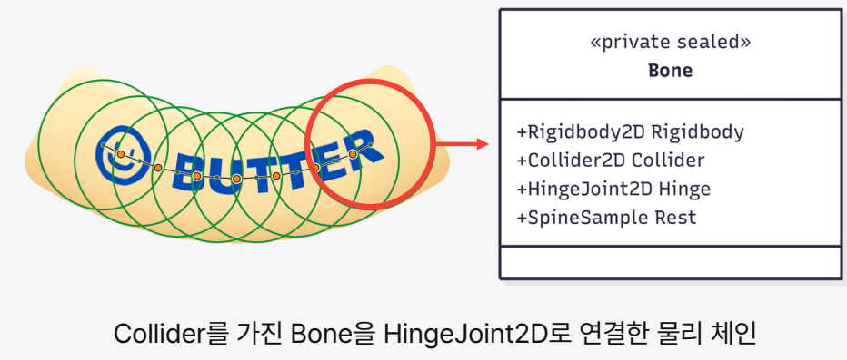
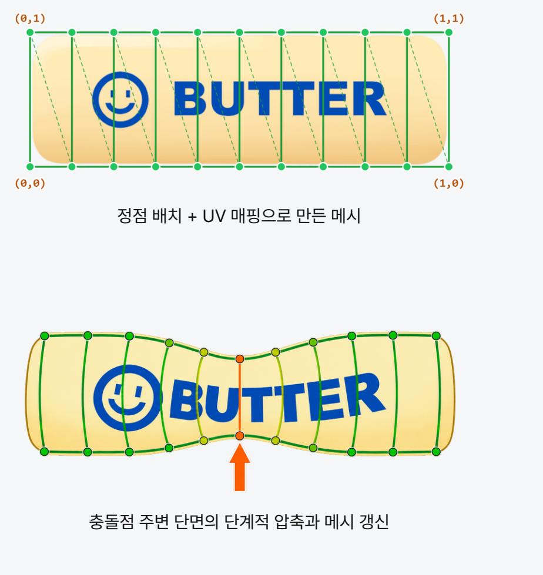
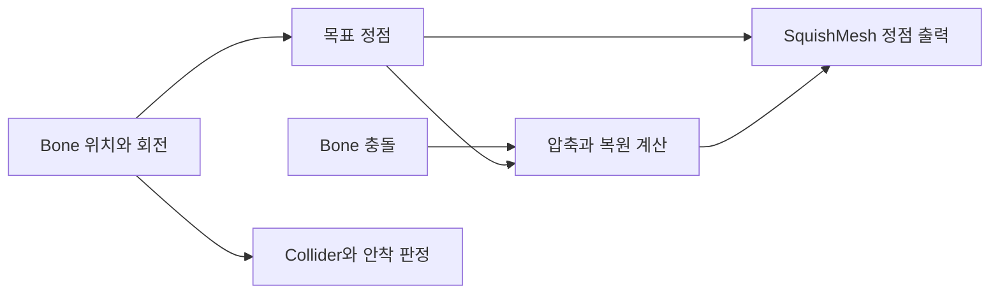

# 관절 체인과 메시 변형으로 구현한 스퀴시

[README](../README.md) · [스테이지 제작](02-stage-pipeline.md)

## 목표와 책임 분리

휘어졌다 탄력 있게 복원되고, 충돌한 부분이 눌리는 스퀴시를 구현했습니다. 물리 판정과 외형 연출이 서로 영향을 주지 않도록 다음 책임으로 나눴습니다.

| 구성 | 책임 | 실행 위치 |
|---|---|---|
| `SquishBody` | 강체 Bone, 관절, 충돌체, 굽힘 복원 | `FixedUpdate` |
| `SquishSegmentRelay` | 각 Bone의 충돌을 몸체에 전달 | 물리 콜백 |
| `SquishDeformationSolver` | 충돌 주변 단면의 압축과 복원 계산 | `SquishMesh.Simulate`에서 호출 |
| `SquishMesh` | Bone을 따라 메시 생성, UV 매핑, 정점 출력 | 시뮬레이션은 `FixedUpdate`, 출력은 `LateUpdate` |
| `SquishSettleDetector` | 속도·접촉 상태에 따른 안착 판정 | 별도 판정 컴포넌트 |

## 굽힘: 강체 조각과 관절 체인




`SquishBody.Build`에서 각 Bone에 `Rigidbody2D`, Collider, 충돌 전달 컴포넌트를 생성하고 이웃 Bone을 `HingeJoint2D`로 연결합니다. 이웃 Bone 사이의 중점을 관절 앵커로 설정하고, 몸체 내부 Collider끼리는 `Physics2D.IgnoreCollision`을 적용합니다.

관절은 연결과 각도 제한을 담당합니다. 일자 형태로 되돌리는 힘은 `ApplyBendingSprings`에서 직접 적용합니다.

```csharp
float errDeg = Mathf.DeltaAngle(a.rotation, b.rotation);
float relVelDeg = b.angularVelocity - a.angularVelocity;

float t = -bendStiffness * (errDeg * Mathf.Deg2Rad)
          - bendDamping * (relVelDeg * Mathf.Deg2Rad);
b.AddTorque(t * b.inertia);
a.AddTorque(-t * a.inertia);
```

- 상대 각도 오차에 비례하는 스프링 항으로 자세를 복원합니다.
- 상대 각속도에 비례하는 댐퍼 항으로 출렁임을 줄입니다.
- 이웃 Bone에 반대 방향의 토크를 적용하고, 관성 값을 곱해 조각의 관성을 반영합니다.
- Inspector에서 강성·감쇠·각도 제한을 조정해 손맛을 튜닝합니다.

각도 제한과 Continuous 충돌 감지는 과도한 변형과 관통 가능성을 줄이기 위한 설정입니다. 모든 충돌 조건에서 관통을 없앤다는 의미는 아닙니다.

읽을 코드: [SquishBody.cs](../Scripts/GamePlay/Controller/Squish/SquishBody/SquishBody.cs), [SquishBody.Build.cs](../Scripts/GamePlay/Controller/Squish/SquishBody/SquishBody.Build.cs), [SquishSegmentRelay.cs](../Scripts/GamePlay/Controller/Squish/SquishBody/SquishSegmentRelay.cs)

## 외형: 고정된 UV와 움직이는 정점




`SquishMesh`는 Bone 체인을 따라 단면을 배치하고 Sprite Texture를 UV로 매핑합니다. 물리 몸체의 위치·회전을 기준으로 목표 정점을 계산하고, 압축 변형을 더해 메시를 출력합니다. UV는 스킨을 적용할 때 구성하며 매 프레임 다시 생성하지 않습니다.

충돌점·충돌 법선·속도는 `SquishDeformationSolver.AddImpact`에 전달됩니다. 충돌점에서 각 단면까지의 거리에 따른 가중치로 압축을 분배하고, `Step`에서 감쇠 스프링의 해석해로 복원 상태를 갱신합니다. 렌더링 시 이전·현재 압축 상태를 보간합니다.



Solver는 압축 상태와 정점 오프셋을 계산하며 Bone·Transform·Collider를 변경하지 않습니다. 덕분에 시각적인 눌림을 추가하면서 물리 접촉과 안착 판정의 기준을 유지할 수 있습니다.

읽을 코드: [SquishMesh.cs](../Scripts/GamePlay/Controller/Squish/SquishMesh.cs), [SquishDeformationSolver.cs](../Scripts/GamePlay/Controller/Squish/SquishDeformationSolver.cs), [SquishSettleDetector.cs](../Scripts/GamePlay/Controller/Squish/SquishSettleDetector.cs)

## 결과와 확인 범위

포트폴리오에는 휘어졌다 복원되는 몸체, 충돌 주변 압축, 물리와 렌더링의 분리를 정리했습니다. 공개 코드에서도 해당 역할 분리를 확인할 수 있습니다. 프레임 시간이나 기기별 성능 수치는 측정 자료가 없어 제시하지 않습니다.

화면과 제작 결과는 [포트폴리오 PDF](../media/portfolio.pdf)의 소프트바디 설명을 기준으로 정리했습니다. 공개 소스에는 이후 개선한 메시 변형 구현이 포함됩니다.
