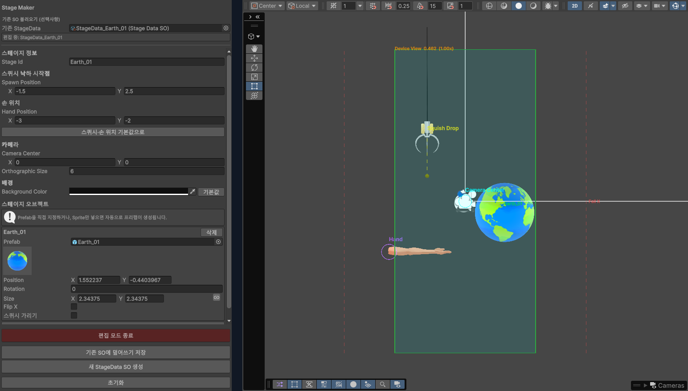
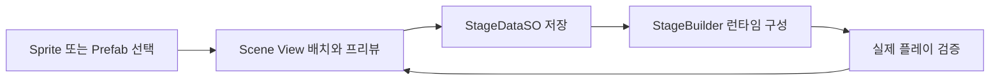
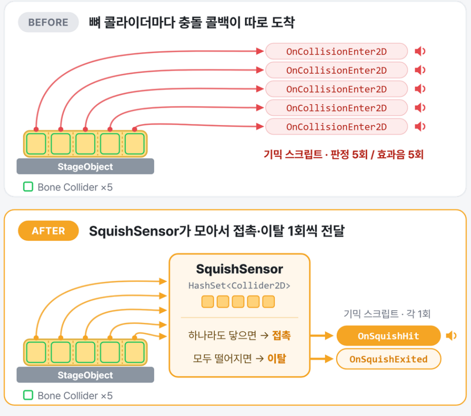

# 기획자가 직접 제작하는 스테이지 파이프라인

[README](../README.md) · [서비스 구조](03-services.md)

## 코드 변경 없이 콘텐츠 제작

기획자가 오브젝트 배치부터 데이터 저장까지 직접 수행하도록 `StageMakerWindow`를 개발했습니다. 위치·회전·크기·좌우 반전과 카메라 설정을 편집하고, Scene View에서 실제 화면 영역과 배치를 확인합니다.

## 에디터와 런타임이 공유하는 데이터

- `StageMakerWindow`: 편집용 작업 데이터를 유지하고 씬 프리뷰와 핸들을 표시합니다. 새 데이터 생성과 기존 데이터 수정에 같은 저장 흐름을 사용합니다.
- `GetOrCreatePrefab`: Sprite만 선택한 경우 `SpriteRenderer`, `PolygonCollider2D`, `StageObject`가 포함된 프리팹을 생성합니다.
- `StageDataSO`: 오브젝트 배치와 카메라 등 스테이지 구성 데이터를 저장합니다.
- `StageBuilder.Build`: 데이터에 따라 스테이지 오브젝트, 손, 스퀴시와 카메라를 구성하고 `StageContext`를 주입합니다. 손과 스퀴시는 재사용하고 스테이지 오브젝트를 교체합니다.

포트폴리오 기준으로 이 제작 흐름을 사용해 **50개 스테이지를 제작하고 실제 플레이 환경에서 검증**했습니다. 공개 저장소에는 코드 구조를 포함하며 50개 스테이지의 원본 에셋은 포함하지 않습니다.

읽을 코드: [StageMakerWindow.cs](../Scripts/Editor/StageMakerWindow.cs), [StageDataSO.cs](../Scripts/GamePlay/Stage/StageData/StageDataSO.cs), [StageListSO.cs](../Scripts/GamePlay/Stage/StageData/StageListSO.cs), [StageBuilder.cs](../Scripts/GamePlay/Stage/StageBuilder.cs), [StageContext.cs](../Scripts/GamePlay/Stage/StageContext.cs)

## 문제 해결: Bone마다 전달되는 충돌 콜백

**문제:** 스퀴시가 한 번 닿아도 효과음과 기믹 반응이 중복 실행됐습니다.

**원인:** 물리 몸체는 여러 Bone Collider로 구성되어 있어 하나의 접촉 구간에 여러 물리 콜백이 발생합니다. 기믹마다 이를 개별 처리하면 중복 실행과 감지 코드 중복이 생깁니다.

**해결:** 공통 베이스 `SquishSensor`에서 닿은 Collider를 `HashSet<Collider2D>`로 추적하고, 논리적인 접촉 상태가 바뀔 때만 알립니다.

| 물리 상황 | 논리 이벤트 |
|---|---|
| 첫 Bone이 접촉 | 접촉 1회 전달 |
| 다른 Bone이 추가 접촉 | 집합에 추가, 접촉 이벤트 반복 없음 |
| 일부 Bone이 이탈 | 집합에서 제거, 나머지가 있으면 접촉 유지 |
| 마지막 Bone이 이탈 | 이탈 처리 |

현재 구현에는 이탈 유예 시간이 있어 짧게 떨어졌다 다시 닿는 경우 기존 접촉을 유지할 수 있습니다. 파괴되거나 비활성화되어 이탈 콜백이 오지 않은 Collider도 집합에서 정리합니다.

실제 충돌을 받는 `SquishContactSensor`는 `ISquishHittable`에 반응을 전달하고, 통과 영역인 `SquishTriggerSensor`는 진입·이탈 이벤트를 제공합니다. 기믹은 Bone 개수를 직접 다루지 않고 이 공통 계약을 이용합니다.

**결과:** 여러 Bone의 물리 접촉을 한 번의 논리 접촉으로 묶어 효과음과 기믹의 중복 반응을 방지했습니다. 완전히 이탈한 뒤 다시 닿으면 새로운 접촉으로 처리합니다.

읽을 코드: [SquishSensor.cs](../Scripts/GamePlay/StageObject/Common/SquishSensor.cs), [SquishContactSensor.cs](../Scripts/GamePlay/StageObject/Common/SquishContactSensor.cs), [SquishTriggerSensor.cs](../Scripts/GamePlay/StageObject/Common/SquishTriggerSensor.cs), [ISquishHittable.cs](../Scripts/GamePlay/StageObject/ISquishHittable.cs)
