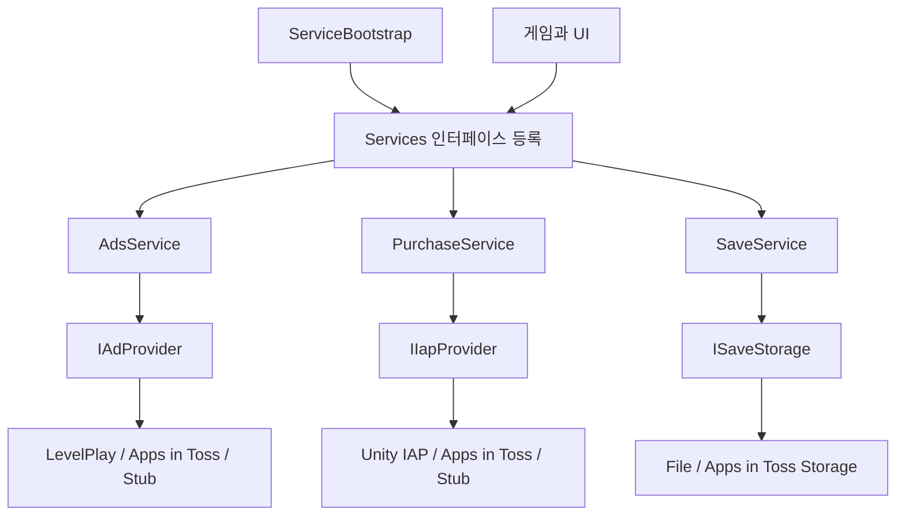

# 서비스 정책과 외부 SDK의 분리

[README](../README.md) · [문제 해결](04-reliability.md)

## 목표

광고·결제 SDK는 플랫폼마다 다르고 일부는 에디터에서 동작하지 않습니다. 게임·UI는 서비스 인터페이스를 이용하고, 플랫폼별 SDK 호출은 Provider 또는 Storage 구현체에 두었습니다.

## 등록과 의존성 연결

`Services`는 타입을 키로 서비스 객체를 보관하는 경량 로케이터입니다. `ServiceBootstrap.Initialize` 한 곳에서 생성·등록 순서와 생성자 의존성을 연결합니다.

| 서비스 | 게임 쪽 정책 | 외부 구현 |
|---|---|---|
| 광고 | 광고 제거 권한, 표시 요청, 준비 상태 전달 | `IAdProvider` |
| 결제 | 상품 권한 지급·복원·회수와 저장 | `IIapProvider` |
| 저장 | 로드 실패 보호와 저장 순서 제어 | `ISaveStorage` |

리더보드는 `ILeaderboardService`의 구현체를 직접 선택합니다. 모든 서비스를 동일한 Service/Provider 이중 계층으로 만들지는 않았습니다.

## 플랫폼별 구현체 선택

| 대상 | 저장 | 광고 | 결제 | 리더보드 |
|---|---|---|---|---|
| Android, 해당 SDK 조건 충족 | 로컬 파일 | 릴리즈 정책에서 LevelPlay | 릴리즈 정책에서 Unity IAP | GPGS |
| 에디터·SDK 미포함 환경 | 로컬 파일 | 일반적으로 Stub | Stub | Stub |
| 앱인토스 WebGL | 앱인토스 Storage | 앱인토스 광고 | 앱인토스 결제 | 비활성 Stub |

정확한 분기는 `#if`, `BuildFlags.IsRelease`, `BuildFlags.UseLiveIap`로 결정합니다. 에디터에서 LevelPlay SDK와 모바일 릴리즈 프로필 조건이 모두 켜져 있으면 광고 Provider를 선택할 수 있으므로, 에디터가 항상 모든 서비스의 Stub 환경이라는 뜻은 아닙니다.

앱인토스 구현체가 포함되어 있다는 것은 연동 확장을 보여줍니다. 앱인토스 출시 완료를 의미하지 않으며, 운영 광고 그룹과 상품 SKU는 별도 설정이 필요합니다.

읽을 코드: [ServiceBootstrap.cs](../Scripts/Core/ServiceBootstrap.cs), [BuildFlags.cs](../Scripts/Core/BuildFlags.cs), [Services.cs](../Scripts/Core/Services.cs)

## 게임 부팅과 외부 서비스 초기화

로컬라이제이션과 저장은 이후 게임 흐름에서 필요하므로 준비를 기다립니다. 반면 분석·결제·광고·리더보드 초기화는 등록을 마친 뒤 `.Forget()`으로 시작해 외부 응답이 게임 부팅을 직접 막지 않도록 구성했습니다.

구매 정보를 받는 스킨 서비스와 광고 제거 정책은 생성자에 필요한 의존성을 전달받습니다. 광고와 결제의 실제 초기화·실패 처리 범위는 각 Service와 Provider에서 확인할 수 있습니다.

## 설계 선택과 한계

서비스 규모에 맞춰 외부 DI 프레임워크 없이 타입 기반 등록·조회를 사용했습니다. SDK 변경 시 Provider를 교체하고 서비스 계약을 유지할 수 있으며, Stub을 통해 외부 SDK 없이 정책 흐름을 다룰 수 있습니다.

로케이터는 호출부의 의존성이 생성자에 모두 드러나지 않는 특성이 있습니다. 이를 줄이기 위해 등록을 Bootstrap에 집중하고, 서비스끼리의 의존성은 생성자로 연결했습니다. 미등록 서비스 조회는 예외로 드러냅니다.

읽을 코드: [AdsService.cs](../Scripts/Core/Ad/AdsService.cs), [PurchaseService.cs](../Scripts/Core/Purchase/PurchaseService.cs), [SaveService.cs](../Scripts/Core/Save/SaveService.cs), [StubAdProvider.cs](../Scripts/Core/Ad/StubAdProvider.cs), [StubIapProvider.cs](../Scripts/Core/Purchase/StubIapProvider.cs)
